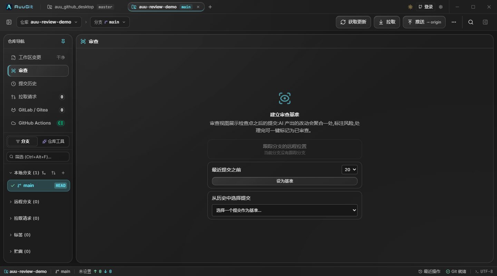
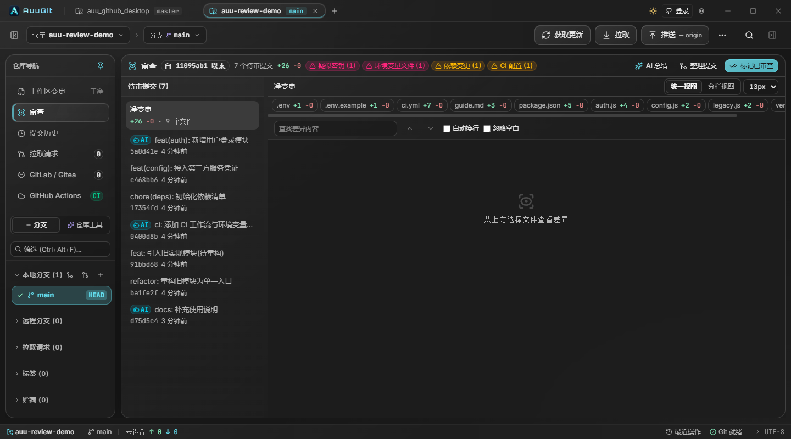
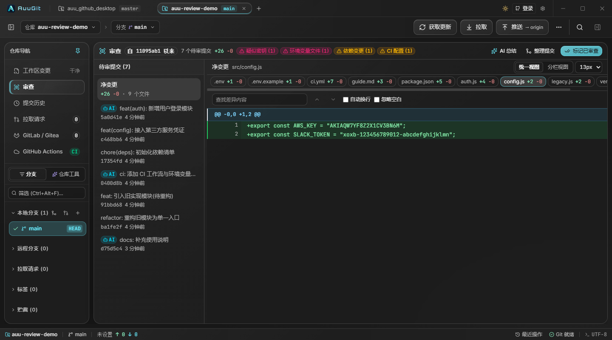
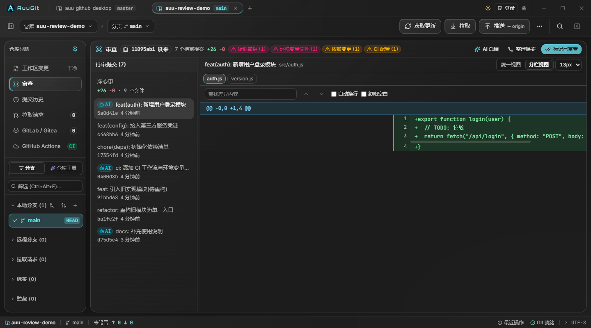
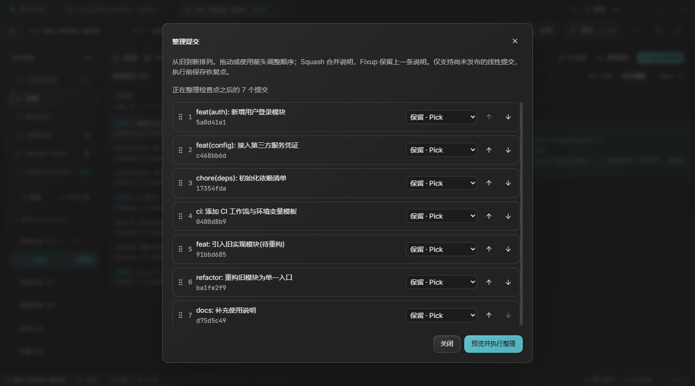
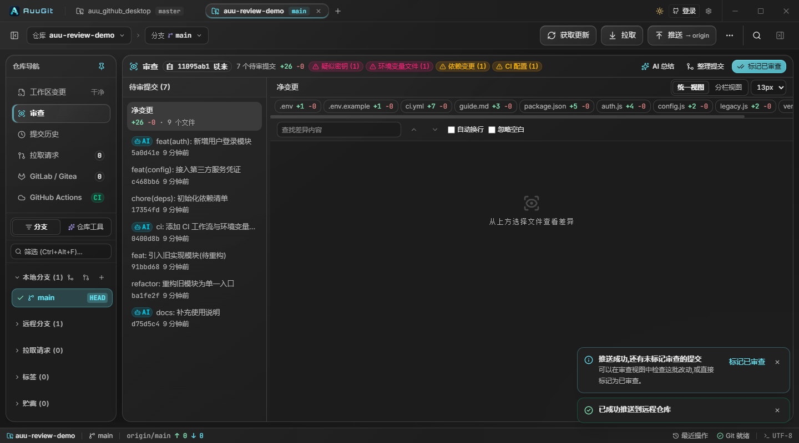
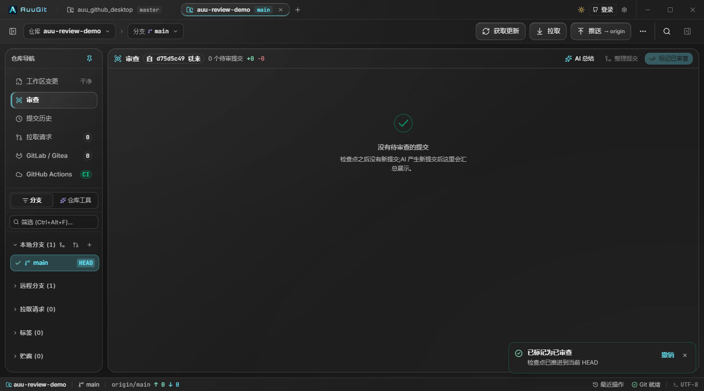
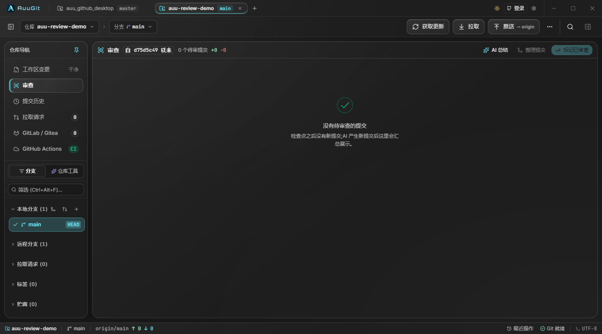

# 代码审核与阶段复核使用指南

> 💡 单文件 HTML 版:[review-guide.html](review-guide.html)——全部截图已内嵌,双击即可离线查看,无需克隆整个仓库。

工作区中的修改可以先审核，再暂存或提交；已有提交则可进入「提交历史 → 阶段复核」，按检查点复核。

## 提交前：在工作区审核

1. 在「工作区变更」选择文件，在差异中逐块通过，或点击「通过此文件」。
   左侧文件列表会显示「已审核」「待审核」、部分代码块的审核进度或未解决意见数，顶部汇总已审和待审数量。同一文件的暂存与未暂存内容分别显示状态；内容刷新后会重新核对审核标记。
   连续审核时可用「通过并继续」通过当前文件并打开下一个待审核版本，也可用「下一个待审核」跳过当前文件。已审核项和冲突文件会跳过，暂存与未暂存版本分别导航。窄列表中状态显示为图标，悬停可查看完整说明。
2. 用代码块的评论按钮或「审核意见」记录问题，修复后标记为已解决，再通过审核。
   如需交给 AI 修改，点击差异工具栏的「AI 修复报告」：报告汇总当前仓库、当前分支所有文件的意见和记录时的原始代码片段，支持预览、复制，以及选择包含已解决意见。代码变化后先核对上下文；未保存原始片段的旧意见会明确提示。
   意见输入支持 Ctrl/⌘+Enter 保存；关闭意见面板或切换文件不会丢失当前会话的草稿，草稿按文件、差异版本与代码块分别保留，关闭应用后清除。删除意见后可在提示中「撤销」。若本地存储失败，审核面板会提示记录仅保留在内存中，请在关闭应用前「重试保存」。
3. 按需要暂存文件或代码块。相同内容暂存后保留审核状态，后续修改需要重新审核；审核标记和暂存状态分别记录。
4. 提交时只检查本次包含的内容。未审核内容和未解决意见默认会提醒，可选择「返回审核」或「继续提交」，不会强制要求审核通过。
5. 可在「设置 → Git → 提交前提醒未审核内容」随时开关提醒，也可在弹窗中勾选「不再提醒」。关闭提醒后仍可手动审核。

审核状态和意见保存在本机，不写入代码文件，也不会推送到远端。以下章节介绍已有提交的检查点审查。

本文截图来自一个模拟「AI 配合开发」的演示仓库(8 个提交,其中 3 个带 AI 署名,故意埋了密钥、.env、依赖与 CI 变更、大量删除等典型风险)。

## 一分钟理解核心概念

- **检查点**:每个分支一个「上次已审查到哪」的标记(存在仓库本地的 `refs/auugit/review/<分支名>` ref 里,不会推送到远端)。
- **最终改动**:检查点到当前 HEAD 的最终代码差异,是本轮主要审查对象。
- **提交记录**:检查点之后各次提交的修改过程,默认折叠,按需展开查看。
- **完成本轮审查**:看完之后点一下,检查点推进到当前 HEAD;操作可撤销。

## 第 1 步:建立审查基准

打开仓库后进入左侧导航的「提交历史」，点击顶部的「阶段复核」。首次使用会引导你选择起点；可随时点击顶部「提交历史」返回提交列表:

三种方式任选:

| 方式 | 适用场景 |
| --- | --- |
| 跟踪分支的远程位置 | 最常用——「从上次同步之后」AI 产出的所有提交都算待审 |
| 最近提交之前 | 快速划定范围,例如只看最近 20 个提交 |
| 从历史中选择提交 | 精确指定某个提交作为起点 |

## 第 2 步:总览本轮提交

基准建立后,左侧以「最终改动」作为主要入口,下方「提交记录」可折叠;顶部展示本轮进度、风险徽标与操作区,右侧展示文件和差异。

- **头部徽标**:本地计算的风险提示,不依赖 AI——
  - 🔴 **疑似密钥**:新增行里出现私钥头、AWS/GitHub/Slack/Google 凭证、JWT、`password=...` 形态的赋值(明显的占位符如 `your-api-key` 会排除)
  - 🟠 **环境变量文件**:提交了 `.env`(模板文件如 `.env.example` 不会标)
  - 🟡 **依赖变更**:`package.json`、`Cargo.toml`、各 lock 文件等
  - 🟡 **CI 配置**:`.github/workflows/`、`.gitlab-ci.yml` 等
  - 🟡 **大量删除** / **二进制文件**
  鼠标悬停徽标可看到具体涉及的文件列表。
- **AI 徽标**:提交信息里带 `Co-Authored-By: Claude/...` 或 `Generated with ...` 署名的提交会被标记为「AI 参与」。
- **最终改动**:汇总「检查点 → 当前 HEAD」的最终结果。检查完这里的代码并处理意见后,即可完成本轮审查。
- **本轮完成度**:统一按最终改动的文件通过状态计算,切换到单个提交时保持不变。

## 第 3 步:看差异

点击任意文件标签查看净差异(所有 AI 提交叠加后的最终效果):

也可以展开「提交记录」,用统一/分栏视图查看每次提交。该操作可选,其中的「已查看」标记只保存个人查看记录,不计入本轮完成度;点「返回最终改动」回到主审查入口:

支持查找(Enter 上/下一个)、自动换行、忽略空白、字号调整;图片文件自动进入图像对比模式。

## 第 4 步(可选):整理嘈杂提交

AI 喜欢把一件事拆成很多小提交。「整理提交」会把检查点之后的所有提交带入历史整理对话框,支持拖动排序、Squash(合并提交信息)、Fixup(丢弃提交信息):

安全护栏:已推送到远端的提交不可改写;操作前自动保存恢复点,出问题可从「仓库工具 → 恢复中心」找回。范围超过 30 个提交时会提示分批整理。

## 第 5 步:推送与推送提醒

推送成功后,如果当前分支还有未标记审查的提交,状态栏右侧会弹出提醒,可直接点击「完成本轮审查」:

## 第 6 步:完成本轮审查

全部看完后点「完成本轮审查」,检查点推进到当前 HEAD。列表清空,并可在 4 秒内点「撤销」恢复:

之后 AI 产生的任何新提交,都会重新出现在这个列表里。

## 分级审查、注释与撤销

- 代码块和文件的通过状态按仓库、分支、基准、HEAD 和审查目标记录。同一版本重启应用后仍保留。新提交到来时,先验证前一轮 HEAD 是当前历史的祖先,再进行增量复审;切换基准或改写历史不会直接沿用旧通过状态。
- 本轮进度只计算最终改动。单次提交的已查看标记单独保存,不会自动通过最终改动中的同名文件;最终改动审查完成后,无需逐个提交再做标记。
- 注释同样区分来源,不会因不同提交恰好使用相同行号而互相覆盖。报告汇总当前范围所有目标的意见,注明最终改动或具体提交及对应行号;中途修改、最终被撤回的文件上的意见也会保留在报告中。
- 点击「撤销」会同时恢复检查点、通过进度与已保存的注释。若检查点已被其他操作修改,撤销会拒绝覆盖。
- 旧版进度没有记录代码版本,升级后不会自动作为当前差异的有效通过状态。

## 增量复审

- 内容和文件属性都没变化的文件会保留通过状态,图片与二进制文件也适用。比较依据是 Git blob 与文件模式,不是文件名或增删行数。
- 文件有变化时会重新进入待审。打开文件后,应用用代码块内容的 SHA-256 指纹验证已审部分:内容完全一致、且前后都能唯一匹配的代码块继续通过,即使行号发生移动。
- 已改动、合并、拆分或存在重复匹配的代码块需要重新检查。文件模式变化也会取消文件整体通过状态;无法读取版本信息时不会自动放行。
- 代码块校验在打开文件时进行,不需要提前为全部文件加载完整差异。

## 处理意见与复核修复

1. 审查时给代码块或文件写意见,默认状态为「待处理」,同时保存原始提交、行范围和代码上下文。
2. 点击顶部「意见」打开意见面板,可筛选、编辑意见,并查看原始代码或跳转到当前差异。
3. 复制报告交给 AI 调整代码。报告默认只包含未解决意见,并附上状态与原始上下文;勾选「包含已解决意见」可导出完整记录。
4. 新提交修改相关文件后,意见会进入「待复核」;代码块能唯一匹配时会更新当前行号。原位置已无法可靠匹配或文件不再出现在差异中时,标为「已过期」,原文和原始代码仍可查看。
5. 检查修复结果后手动改为「已解决」;仍有问题可重新设为「待处理」。代码变化或文件消失都不会自动把意见判定为已解决。
6. 可勾选多条意见后点「所选已解决」,或用「全部已解决」处理当前筛选结果。其他筛选中隐藏的意见不受影响;操作后的提示提供撤销。筛选已解决意见后,也可批量重新打开所选意见。

审查进度保存失败时,界面会持续提示并提供「重试保存」,仍可查看差异、编辑意见;关闭或刷新前请确认保存成功。差异读取失败时可直接重试当前文件。

历史进度通常保留最近 50 个版本范围,并额外保护未解决意见的最新副本,避免活跃分支产生大量提交时丢失其他分支的待处理意见。已解决或已有更新副本的旧范围可以清理。

还有未解决意见时推进检查点,会明确提醒本轮审查将结束;撤销仍能恢复本轮意见与进度。

## AI 总结

点右上角「AI 总结」,会对整段待审范围做一次 AI 分析:顶部展开一段总览(这段时间做了什么、哪里需要人工注意),每个提交下方显示一句意图说明。首次使用需在「设置 → AI」中配置兼容 API(endpoint、模型、API key)。

## 常见问题

**检查点存在哪里?会不会影响仓库?**
存在仓库本地 `.git` 目录下的自定义 ref(`refs/auugit/review/<分支名>`)中。它不参与构建、不会被推送,克隆到别的机器后不存在,可随时用 `git update-ref -d refs/auugit/review/<分支名>` 删除。

**变基 / 强制推送之后会怎样?**
视图会检测到检查点已不在当前分支历史上,顶部出现黄色提示条,一键「重建为当前 HEAD」或「重新选择基准」;数据不会静默丢失。

**为什么我的整理按钮是灰的?**
待审范围内包含合并提交(非线性历史)时,历史整理不可用。可以先在「提交历史」里处理合并,或调整审查基准。

**风险徽标是 AI 生成的吗?**
不是。风险检测完全在本地用规则计算,离线可用;只有「AI 总结」需要联网调用模型。检测只做提示、绝不自动删除或阻断任何内容——判断权始终在你。
